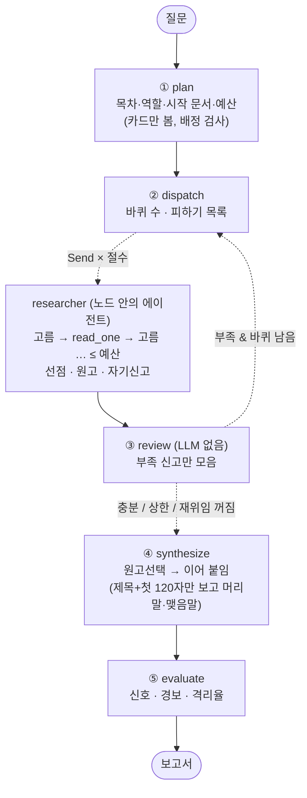
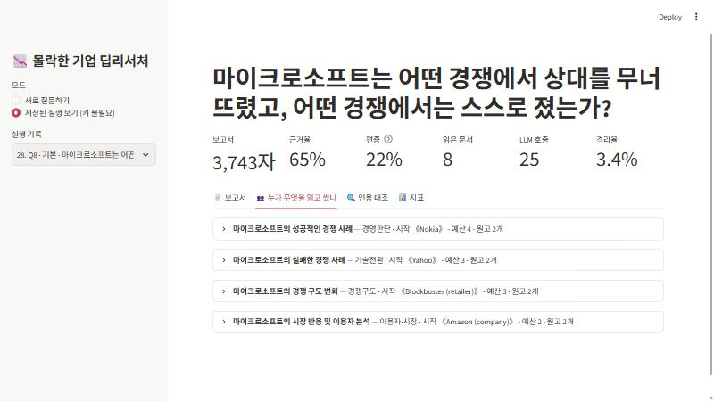
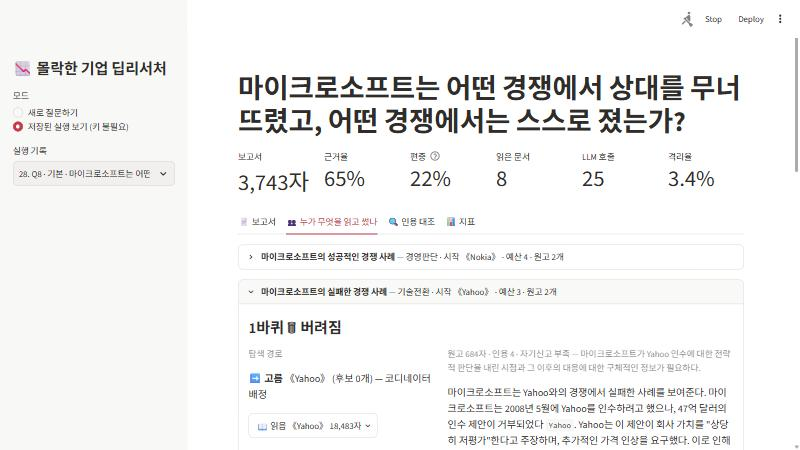

# REPORT — 몰락한 기업 딥리서처

> ✍️ 표시는 직접 읽고 판단을 적어야 하는 자리입니다. 숫자와 관찰은 실행 기록(`output/`)에서 가져왔습니다.

## 1. 주제와 코퍼스

**주제: 한때 업계 1위였던 기업들은 왜 무너졌나.** "블록버스터는 넷플릭스에, 노키아는 아이폰에" 같은 이야기는 누구나 들어 봤지만, 원인은 기업마다 다르고 여러 문서에 흩어져 있어서 한 문서로는 답이 나오지 않습니다. 몰락 기업과 함께 이긴 쪽(넷플릭스·아이폰·후지필름)과 이론(파괴적 혁신)을 같이 넣어 "누가 왜 갈렸나"를 비교할 수 있게 했습니다.

| 항목 | 값 |
|---|---|
| 출처 | 영어 위키백과 (CC BY-SA 4.0). 한국어판은 핵심 몰락 기업 문서가 너무 짧아서 제외 (노키아 4.9KB, 블랙베리 6KB) |
| 문서 | **48건** — 몰락 기업 31, 승자·대조 8, 개념·기술 9 |
| 분량 | 1,637,671자 = **실측 344,731토큰** (o200k_base) → gpt-4o-mini 윈도우 128,000의 **2.7배** |
| 링크 | 코퍼스 안 내부 링크 **316개** |
| 링크 특이점 | 《Theranos》 나가는 링크 0 (읽고 나면 코퍼스 전체에서 후보를 찾음) · 《WeWork》 들어오는 링크 0 (배정이 유일한 경로) |
| 링크 쏠림 | 들어오는 링크 상위: Apple 22, Microsoft 21, Amazon 20, Android 17, Google 16 → 링크만 따라가면 승자 문서로 몰릴 위험 |

질문 10개(`data/questions.json`)를 세 유형으로 섞었고, 질문마다 "왜 나눌 만한가"를 한 줄로 적었습니다.

| 유형 | 질문 | 의도 |
|---|---|---|
| 단일 | Q1 블록버스터, Q2 테라노스 | **이 구조를 쓰면 안 되는 경우**를 보이려고 일부러 넣음 |
| 분산 | Q3 1위 기업들의 공통 원인, Q4 닷컴 버블, Q5 스마트폰 이후 휴대폰 강자들, Q6 회계 부정·사기, Q10 싸이월드·마이스페이스·프렌드스터 | 기업별·원인 갈래별로 나누면 리서처마다 다른 문서를 읽음 |
| 추적 | Q7 코닥 vs 후지필름, Q8 마이크로소프트의 승패, Q9 파괴적 혁신 이론의 적용 범위 | 한 대상을 따라 링크를 타야 함 |

## 2. 분업 설계

### 목차 규칙: 내용 단위로 나눈다
코디네이터에게 기업별·원인 갈래별·시기별로 나누라고 지시하고, "개요/배경/분석/결론/연표"는 금지했습니다. 형식 단위로 나누면 모든 리서처가 같은 문서를 읽기 때문입니다. 절 제목에 형식 단어가 있으면 코드가 `형식 단위 의심`으로 기록합니다.

### 역할 명단 (`config.json`)
| 역할 | 지시 |
|---|---|
| 기술전환 | 어떤 기술 변화가 핵심 사업을 위협했고, 회사가 그 기술을 언제 알고 어떻게 다뤘나 |
| 경영판단 | 인수·투자·철수·전략 전환의 시점, 이유, 결과 |
| 경쟁구도 | 누가 앞질렀고 무엇이 달랐나 |
| 재무·자본 | 매출·부채·주가·회계로 본 몰락 과정 |
| 이용자·시장 | 고객이 왜, 언제, 어디로 떠났나 |

### 배정·구역 규칙
- **시작 문서:** 코디네이터가 문서 카드(제목 + 앞 300자, 전체의 약 0.9%)를 보고 절마다 다른 문서를 배정합니다.
- **배정 검사:** 모델이 쓴 문서 이름을 코드가 실제 문서와 맞춰 봅니다. 못 맞추면 `지어낸 문서 이름`으로 기록하고, 예비 후보 → 아직 안 쓴 문서 순으로 교정합니다. 처음에는 문서 제목을 enum으로 묶으려 했지만, 《Toys "R" Us》의 따옴표를 OpenAI 구조화 출력이 거부해서 코드 검사로 바꿨습니다.
- **예산:** 코디네이터가 절마다 2~4건을 정하고, 코드가 합계를 12건(=절수×절예산)에 맞춥니다. 대조군과 총예산을 같게 하기 위해서입니다.
- **남의 구역:** 다른 절의 시작 문서와, 2바퀴부터는 다른 절이 이미 읽은 문서를 피하기 목록으로 줍니다.
- **선점 (수업 대비 추가):** 수업 실험에서 2바퀴에 동시에 출발한 리서처 4명이 모두 《개화파》로 몰렸습니다. 피하기 목록은 지난 바퀴에 읽은 문서만 알기 때문입니다. 그래서 같은 바퀴 안에서는 먼저 고른 리서처가 문서를 갖도록 했습니다. LLM을 다시 부르지 않고 코드가 다음 후보로 넘깁니다.

### 서브에이전트 규칙
- **격리 경계:** 원문은 `read_one()` 안에서만 쓰이고, 위로는 원고와 자기신고만 올라갑니다.
- **멈출 수 있음:** 상관없는 후보밖에 없으면 "없음"을 골라 예산을 남깁니다(수업 코드는 억지로 다 읽었음).
- **인용 형식:** 모든 문장의 마침표 앞에 《영문 문서명》을 붙입니다. 예시까지 넣었더니 근거율이 13% → 88%로 올랐습니다.
- **인용 이름 교정:** 《Blockbuster》 → 《Blockbuster (retailer)》처럼, 그 리서처가 **실제로 읽은 문서 하나로만** 맞춰질 때만 코드가 고칩니다. 진짜 허위 인용은 그대로 둬서 경보에 걸리게 합니다.

### 재위임 규칙
- 자기신고 `부족`인 절만 다시 보내고, 상한은 `최대바퀴=2`입니다.
- **사유 없는 `부족`은 무효:** 무엇이 부족한지 못 대면 재조사 지시를 만들 수 없습니다. 첫 구현에서는 4절 모두가 사유 없이 `부족`을 냈습니다.
- **새로 읽은 문서가 없으면 다시 쓰지 않음:** 첫 구현에서 새 문서 0건으로 다시 쓴 원고에 허위 인용 3개가 생겼습니다.
- **두 번째 원고 처리 (`원고선택`):** 허위 인용이 없고 인용 수가 같거나 많을 때만 첫 원고를 대체합니다. 이유는 수업 소거 실험에서 "마지막 원고가 무조건 덮어쓰기" 때문에 인용이 빠진 원고가 멀쩡한 원고를 지웠기 때문입니다.

## 3. 지표 — 정답표도 판정 모델도 없이 (`metrics.py`)

**신호 (높낮이를 견준다)**
| 지표 | 한 줄 설명 | 보는 장치 |
|---|---|---|
| 근거율 | 인용이 붙은 문장 ÷ 전체 문장 | 조사 깊이 · 재위임 · 원고선택 |
| 편중 | 가장 많이 인용된 문서 하나의 인용 비율 | 배정구역 · 선점 |
| 중복률 | 두 절 이상이 읽은 문서 ÷ 읽은 문서 | 배정구역 · 선점 |
| 읽고안씀 | 읽었지만 한 번도 인용 안 된 문서 수 | 배정(카드) 품질 · 질문이 나눌 만한가 |
| 최소절인용 | 인용이 가장 적은 절의 인용 수 | 역할 · 원고선택 |
| 글자수 | 보고서 길이 | 폭 · 깊이 |

**경보 (0이어야 한다 — 하나라도 있으면 그 보고서는 평균에서 뺀다)**
| 경보 | 뜻 |
|---|---|
| 허위인용 | 팀의 누구도 읽지 않은 문서를 인용 |
| 절밖인용 | 그 절의 리서처가 읽지 않은 문서를 인용 (다른 절이 읽었어도 이 절은 자기 지식으로 쓴 것) |
| 인용0절 | 인용이 하나도 없는 절 |
| 누락절 | 최종 원고가 보고서에 안 들어간 절 |

**비용 (따로 기록)**
- 호출 수와 시간
- **격리율:** 코디네이터 입력 글자 ÷ 전체 입력 글자. LLM 호출마다 누가 몇 자를 넣었는지 직접 셉니다.

**측정 규칙을 의심한 기록**
- **문장 분리:** 수업 교안은 마침표 뒤에 붙은 인용이 다음 문장으로 넘어가서 근거율이 실제보다 낮게 잡혔습니다(67% vs 85%). `문장들()`은 그런 인용을 앞 문장에 되돌려 붙이고, 제목 줄과 `(… 담당)` 꼬리표를 뺍니다.
- **지표 재계산:** `ablation.py --summarize`는 저장된 숫자가 아니라 **지금의 `metrics.compute`로 다시 계산**합니다. 규칙을 바꾸면 모든 설정이 함께 바뀌어서, 규칙 변경을 성능 변화로 착각하지 않습니다.
- **스위치 확인:** 오타로 스위치가 안 꺼지는 사고를 막으려고, 없는 설정 이름을 넘기면 `stream_run`이 에러를 냅니다. 실행 당시 설정도 기록마다 함께 저장해서, 실제로 꺼졌는지 확인할 수 있습니다.

## 4. 파이프라인 구조

**State 흐름**
| 키 | 쓰는 노드 | 비고 |
|---|---|---|
| `run_id`, `question` | 입력 | `run_id`로 실행별 장부(호출 수, 코디네이터/서브 입력 글자 수, 선점 표)를 찾음 |
| `sections`, `report_title`, `plan_notes` | plan | `plan_notes` = 배정 검사 결과 |
| `drafts` | researcher | `Annotated[list, operator.add]` 리듀서. 버려진 원고까지 모두 쌓임 |
| `round`, `retry`, `종료` | review | `종료` = 충분 / 최대바퀴 도달 / 재위임 꺼짐 |
| `report`, `finals` | synthesize | `finals` = 원고선택을 거친 절별 최종 원고 |
| `metrics` | evaluate | |

## 5. 실험 결과 (`output/ablation.json`, 설정마다 2회 평균, 괄호는 최소~최대)

### Q5 — 분산형 (스마트폰 이후 휴대폰 강자들)
| 설정 | 근거율 | 편중 | 중복률 | 글자수 | 호출 |
|---|---|---|---|---|---|
| 기본 | 83% (82~84) | 18% | 0% | 4,302 | 26 |
| 배정구역 끔 | 84% | **28%** (19~37) | **17%** | 3,888 | 28 |
| 역할 끔 | 89% | 19% | 0% | 3,845 | 22 |
| 재위임 끔 | 84% | 20% | 0% | 3,716 | 20 |
| 선점 끔 | 86% | 26% | 0% | 3,117 | 20 |
| 원고선택 끔 | 84% | 22% | 0% | 3,510 | 22 |
| **단일 에이전트** | **48%** | 26% | 0% | **1,681** | 25 |

### Q8 — 추적형 (마이크로소프트의 승패)
| 설정 | 근거율 | 편중 | 중복률 | 글자수 | 호출 |
|---|---|---|---|---|---|
| 기본 | 73% (65~80) | 18% | 0% | 5,007 | 32 |
| 배정구역 끔 | 86% | **55%** (48~62) | **70%** (40~100) | 4,564 | 32 |
| 역할 끔 | 75% | 21% | 0% | 4,028 | 26 |
| 재위임 끔 | 65% | 21% | 0% | 3,894 | 22 |
| 선점 끔 | 76% | **43%** (31~55) | **20%** | 4,974 | 28 |
| 원고선택 끔 | 78% | 26% | 0% | 4,668 | 30 |
| **단일 에이전트** | **38%** (24~52) | 27% | 0% | **2,371** | 25 |

### Q1 — 단일형 (블록버스터) · 이 구조를 쓰면 안 되는 질문
- **기본·역할 끔·재위임 끔·선점 끔·원고선택 끔: 10회 중 10회 경보** (`절밖인용`, `허위인용`). 《Blockbuster (retailer)》는 한 리서처만 읽을 수 있는데, 나머지 셋도 자기 지식으로 《Blockbuster》를 인용했습니다(예: 《Netflix》만 읽은 "경쟁사" 절).
- **배정구역 끔:** 경보는 없지만 **중복률 100%, 편중 87%**. 4명이 모두 같은 문서를 읽었습니다.
- **단일 에이전트:** 경보 없음. 1,776자로 질문에 비해 충분합니다.
- 결론: 문서 한 건짜리 질문을 나누면 **구역을 지키면 지어내고, 구역을 풀면 똑같은 일을 4번 합니다.** 앞단에 "나눌 질문인가"를 고르는 라우팅이 필요하다는 근거입니다.

### 해석 — 무엇이 값을 했나
| 장치 | 결과 | 판단 |
|---|---|---|
| **팀 vs 단일** | 근거율 +35%p, 분량 약 2배 (Q5·Q8 4회 모두 같은 방향). 호출 수는 비슷 | 같은 예산이면 나누는 쪽이 낫다. 단일 쪽은 12건 중 12건을 모두 읽음(예산미달 0) |
| **배정구역** | 끄면 편중·중복률이 크게 오름 (Q8 편중 18→55%, 중복 0→70%) | 가장 확실함. 수업 결과와 같음 |
| **선점** | 끄면 Q8 편중 18→43%, 중복 0→20%. Q5는 작음 | 효과 있음. 승자 문서(Microsoft·Apple)로 링크가 몰리는 추적형 질문에서 큼 |
| **재위임** | 끄면 호출 −6~10, 근거율 Q8에서 −8%p, Q5 변화 없음 | 수업과 달리 근거율을 떨어뜨리지 않았음. 원고선택과 "새 문서 없으면 재작성 안 함" 덕분으로 추정. 2회라 단정 못 함 |
| **원고선택** | 끄면 Q8 편중 +8%p, Q5 근거율 범위가 넓어짐(79~89) | 이번 표본에서는 효과를 확인하지 못함 |
| **역할** | 끄면 큰 차이 없음 (Q5 근거율은 오히려 +6%p) | 이번 표본에서는 효과를 확인하지 못함. 인물 추적 질문(수업의 김옥균)에 해당하는 질문을 더 넣어야 함 |

같은 설정도 시행마다 Q8 근거율이 65~80%처럼 15%p씩 움직였습니다. 차이가 그 안에 있는 장치(역할·원고선택·재위임의 근거율)는 "효과 없음"이 아니라 **"이번 표본에서는 확인하지 못함"** 입니다.

## 6. 직접 읽고 비교한 것

자동 지표로 걸러지지 않은 문제들입니다.

1. **단일 에이전트 Q8의 오귀속:** "마이크로소프트는 비디오 게임 산업에서 아타리와의 경쟁에서 상대를 무너뜨렸다《Atari, Inc.》"라는 절이 있습니다. 아타리의 1983년 몰락은 마이크로소프트와 무관합니다. 문서는 실제로 읽었으니 허위 인용도 절밖 인용도 통과합니다.
2. **팀 Q8 기본의 이상한 배정:** 마이크로소프트 질문인데 "경쟁 구도" 절의 시작 문서가 《Blockbuster (retailer)》, "실패 사례" 절은 《Yahoo》였습니다. 절 제목도 "성공 사례 / 실패 사례 / 경쟁 구도 / 시장 반응"이라 형식 단위에 가깝습니다. 형식 단어 검사(`개요|배경|결론…`)로는 걸리지 않았습니다.
3. **팀 Q5:** 노키아 절은 《Nokia》→《Symbian》→《Windows Phone》→《Microsoft》로 링크를 따라가며 예산 4건을 다 썼습니다. 모토로라 절은 《IPhone》·《Android》를 다른 절이 선점해서 1건만 읽고 멈췄습니다. **선점의 대가**입니다. 경쟁 제품 문서는 모든 절이 배경으로 필요한데, 한 절만 갖게 됩니다.

✍️ **직접 작성할 것:** Q5·Q8에서 기본 보고서와 단일 에이전트 보고서를 나란히 읽고, 어느 쪽이 나은지와 그 이유를 적습니다. 파일은 `output/reports/Q5_기본_1.md` vs `Q5_단일에이전트_1.md`입니다. 데모의 "🔍 인용 대조" 탭에서 인용 몇 개를 원문 요약과 맞춰 본 결과도 적습니다.

## 7. 데모 설계 (`app.py`)

- **"누가 무엇을 읽고 썼나"가 중심 탭입니다.** 절마다 시작 문서, 예산, 바퀴별 원고를 보여 주고, 원고마다 ✅ 보고서에 들어감 / 🗑 버려짐을 표시합니다. 왼쪽에는 탐색 경로(고름 → 읽음 / 🚫 관련 없음 / ⏹ 멈춤과 그 이유), 오른쪽에는 원고와 자기신고를 둡니다. 숫자만 보여 주면 이 프로젝트의 요점인 분업이 안 보이기 때문입니다.
- **실시간 진행:** `stream_run()`이 노드별 업데이트를 내보내서, 목차 → 리서처별 완료 → 재위임 여부가 실행 중에 나타납니다.
- **인용 대조 탭:** 인용 문장과, 리서처가 그 문서에서 실제로 뽑은 요약을 나란히 놓습니다. 오귀속은 사람만 잡을 수 있어서 사람이 대조하기 쉽게 만들었습니다.
- **지표 탭:** 신호와 경보를 나누고, 지표마다 "보는 장치"를 같이 표시합니다. 격리는 코디네이터와 서브에이전트의 입력 글자 수 막대로 보여 줍니다.
- **스위치:** 사이드바에서 장치 5개와 폭·깊이를 바꿔 직접 소거 실험을 해 볼 수 있습니다.
- **키 없이 보기:** "저장된 실행 보기" 모드는 `output/runs.jsonl` 42건을 엽니다.
- 한계: 설정이 프로세스 전역이라 여러 사람이 동시에 실행하면 섞입니다. 로컬 데모 전제입니다.

✍️ 질문을 직접 입력해 실행한 화면(진행 상태, 보고서 탭)을 캡처해 추가하세요.

## 8. 회고

**가장 공들인 부분** (✍️ 자기 말로 다듬으세요)
- **"좋아진 줄 알았는데"를 의심한 과정입니다.**
  - 첫 실행의 근거율 13%는 인용 형식 지시 문제였고, 88%로 올린 뒤에도 문장 분리 규칙 때문에 숫자가 틀릴 수 있어서 규칙을 고정하고 재계산하게 했습니다.
  - Q1의 허위 인용 경보는 처음에 이름 표기 문제로 보고 교정 코드를 넣었습니다. 그런데 다시 돌려도 남아서 원문을 확인해 보니, **실제로 읽지 않은 리서처들이 지어낸 인용**이었습니다. 이 결과로 `절밖인용` 경보를 새로 만들었습니다.
- **대조군을 묶지 않기:** 단일 에이전트는 `allow_stop=False`로 예산을 끝까지 쓰게 하고, 예산미달을 기록합니다(실제 0건).

**향후 개선**
1. **앞단 라우팅:** Q1처럼 문서 한 건으로 답이 나오는 질문은 단일 에이전트로 보냅니다. 판단 신호로는 카드 기준 관련 문서 수를 생각하고 있습니다.
2. **공유 배경 문서:** 선점 때문에 《IPhone》·《Android》 같은 공통 배경 문서를 한 절만 갖습니다. "공용 문서"는 선점에서 빼고 요약을 공유하는 방법을 검토합니다.
3. **절 사이 일관성:** 편집자는 본문을 고치지 않아서 같은 사건이 두 절에 반복됩니다. 인용을 건드리지 않는 중복 표시만 해 주는 단계를 생각합니다.
4. **더 많은 반복:** 설정당 2회로는 15%p 흔들림을 넘는 차이만 말할 수 있습니다. 역할·원고선택은 5회 이상 반복이 필요합니다.
5. **오귀속 보조 지표:** 수업 교안이 버린 어휘 겹침 지표 대신, 인용 문장과 리서처 요약의 개체명(연도·사람·회사) 겹침을 "검토 대상 표시"로만 쓰는 방안을 검토합니다. 순위가 아니라 사람이 볼 곳을 좁히는 용도입니다.
